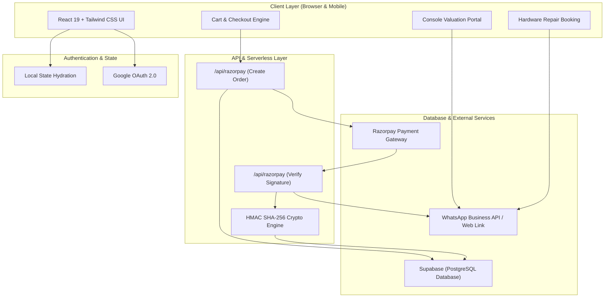

# Project Description: DJN Tech — Next-Gen Gaming Store & Hardware Platform

---

## 📌 Executive Summary

**Project Name:** DJN Tech — Consoles, Controllers & Pre-Owned Games Store  
**Client:** DJN Tech Official (Founder: Danny Dharia)  
**Location:** Mumbai, Maharashtra, India  
**Industry:** Gaming Hardware, Consumer Electronics & E-Commerce  
**Repository:** `djntechofficial-art/DJN-Website`  
**Tech Stack:** React 19, TypeScript, Vite, Tailwind CSS v4, Express/Serverless API, Supabase (PostgreSQL), Razorpay SDK, Motion, Lucide Icons  

---

## 🏢 About the Client

**DJN Tech** is an independent, enthusiast-driven gaming enterprise based in Mumbai, India. Founded and spearheaded by **Danny Dharia**, DJN Tech was established to bridge a major gap in the Indian gaming market: providing authentic, high-quality, and affordable gaming consoles, official controllers, pre-owned game discs, and specialized repair services without the inflated margins and rampant mistrust common in grey markets.

### The Problem in the Indian Gaming Market
1. **High Cost of Entry:** Brand-new consoles and AAA games carry steep import tariffs and premium pricing in India, making gaming inaccessible to many aspiring players.
2. **Pre-Owned Market Skepticism:** The used games and refurbished hardware ecosystem in India suffers from high fraud rates—scratched discs, counterfeit controllers with severe stick drift, banned consoles, and lack of warranties.
3. **Lack of Specialized Repair Hubs:** Gamers with overheating PlayStation 5 consoles (liquid metal dry-out), broken HDMI 2.1 ports, or joystick drift have few dependable, certified repair centers outside expensive authorized swap programs.
4. **Friction in Selling / Trade-ins:** Gamers looking to upgrade have to haggle on unmoderated classifieds, dealing with unreliable buyers and scam payment proofs.

### DJN Tech’s Unique Proposition
DJN Tech positions itself as India's premier, trusted destination for gaming hardware by offering:
- **100% Laser-Tested Pre-Owned Discs** backed by a **7-Day Doorstep Replacement Guarantee**.
- **Certified 25-Point Quality Assurance** for pre-owned PS5, PS4 Pro, and Xbox Series X consoles.
- **Transparent Instant Trade-In Valuation** with hassle-free doorstep pickup.
- **Dedicated Repair & Servicing Desk** specializing in HDMI 2.1 replacements, liquid-metal thermal repasting, and DualSense stick drift calibration.

---

## 🎯 Client Goals & Objectives

The primary goal was to build a modern, high-converting, lightning-fast digital storefront and service portal that reflects DJN Tech’s reputation for authenticity and uncompromising quality.

Key client objectives included:
1. **Unified Gaming Ecosystem:** Create a single seamless platform for four core business verticals:
   - **New & Certified Pre-Owned Consoles** (PS5 Slim, PS4 Pro, Xbox Series X)
   - **Genuine Accessories & Controllers** (DualSense, Wireless Xbox Controllers)
   - **Discounted Pre-Owned Game Discs** (benchmarked at ~40% off retail market rates)
   - **Sell / Trade-in & Repair Portals** (instant automated valuation calculator and repair scheduling)
2. **Frictionless Indian Payment & Order Flow:**
   - Integrate an official **Razorpay payment gateway** supporting UPI (Google Pay, PhonePe, Paytm), NetBanking, and credit/debit cards.
   - Complement digital payments with an automated **WhatsApp Order Sync** that pushes order details directly to the store’s fulfillment desk.
3. **Dynamic Administrative Autonomy:**
   - Provide an intuitive, secure **Admin Panel** where the store team can update product prices, add new inventory, adjust shipping fees, configure promotional banners, and monitor business analytics without developer intervention.
4. **Mobile-First & Ultra-Snappy Experience:**
   - Over 85% of target Indian gamers browse on mobile devices. The web app had to feel like a native mobile app—featuring smooth bottom sheet drawers, sticky navigation, OLED dark mode, and zero page lag.
5. **Brand Authority & Social Proof:**
   - Integrate verified customer reviews, clear guarantee badges, live delivery tracking, and rich social media previews for WhatsApp and Instagram shares.

---

## ⚠️ Challenges Encountered & How We Solved Them

Building an e-commerce platform with live payment processing, complex trade-in logic, and dynamic pricing came with several non-trivial engineering and business challenges. Here is how each was addressed:

```
┌────────────────────────────────────────────────────────────────────────────────────────┐
│                               CHALLENGES & SOLUTIONS OVERVIEW                          │
├───────────────────────────────┬────────────────────────────────────────────────────────┤
│ Challenge                     │ Solution Implemented                                   │
├───────────────────────────────┼────────────────────────────────────────────────────────┤
│ 1. Payment Security & Fraud   │ Server-side HMAC SHA-256 validation & order locking   │
│ 2. Catalog & Dynamic Pricing  │ Automated scrapers & Steam/PlayStation CDN resolvers   │
│ 3. Social Media Link Sharing  │ Custom 1200x630 OpenGraph cards for crisp previews     │
│ 4. Third-Party DOM Conflicts  │ Defensive shadow-DOM isolation & lazy loading          │
│ 5. Admin Hierarchy & Security │ Two-tier role enforcement (Superadmin vs Admin)        │
│ 6. Mobile UX & Drop-off Rates │ Native 5-tab bottom navigation & 1-tap Google OAuth    │
└───────────────────────────────┴────────────────────────────────────────────────────────┘
```

### 1. Payment Gateway Security & Price Tampering Prevention
* **The Challenge:** In standard client-side Razorpay integrations, malicious actors can inspect and modify frontend JavaScript payloads (e.g., changing the checkout amount or spoofing payment success callbacks) before order placement.
* **How We Solved It:**
  - Architected a secure server-side API layer (`api/razorpay.ts`) using Node.js and cryptographic `crypto.createHmac`.
  - The client no longer passes amounts directly to Razorpay. Instead, it sends cart item IDs. The backend recalculates item prices directly against the verified database, creates an authentic Razorpay Order ID, and validates payment responses using secret keys and `HMAC-SHA-256` signature verification.
  - Test transactions were locked down with a dedicated ₹1 verification product accessible only to authorized administrators for live-mode testing.

### 2. Catalog Ingestion & Dynamic Market Repricing
* **The Challenge:** DJN Tech stocks dozens of high-demand PlayStation and Xbox game titles whose secondary market values fluctuate weekly. Manually searching for high-resolution cover artwork, descriptions, and current retail market prices on Amazon India or Steam was tedious and prone to human error.
* **How We Solved It:**
  - Engineered a suite of Node.js automation scripts (e.g., `scripts/reprice_strictly_amazon_only.mjs`, `scripts/game_image_resolver.mjs`, and `scripts/apply_catalog_update.mjs`).
  - Automated retrieval of official 4K/high-res game cover assets from PlayStation and Steam CDNs, ensuring consistent visual appeal.
  - Built an algorithm to benchmark pre-owned prices at a strict ~40% discount off live Amazon India retail prices, syncing calculated prices directly into Supabase in automated batches.

### 3. WhatsApp Social Previews & Brand Visibility
* **The Challenge:** In the Indian gaming market, word of mouth and WhatsApp group sharing drive the vast majority of traffic. Early links shared on WhatsApp generated squished, low-resolution thumbnail squares or missing titles, lowering click-through rates.
* **How We Solved It:**
  - Designed an optimized, high-contrast **1200×630 OpenGraph banner** (`og-banner.png`) featuring high-visibility branding, trusted badges ("100% Tested", "7-Day Guarantee"), and platform icons.
  - Configured strict HTML meta tags, Twitter card specifications, and server headers ensuring that any link shared via WhatsApp, Telegram, or Instagram renders an expansive, attractive preview card.

### 4. Third-Party Review Widget Conflicts & React 19 Hydration
* **The Challenge:** To build immediate trust, the client requested a live Google Maps Reviews showcase. Third-party embedded widgets (such as Elfsight) injected heavy external scripts, intrusive vendor watermarks, and direct DOM mutations that conflicted with React 19’s strict virtual DOM reconciliation, causing hydration mismatch warnings and page crashes.
* **How We Solved It:**
  - Implemented an isolated shadow-DOM observer and custom lifecycle cleanup hooks that prevented DOM mutation collisions during client routing.
  - Suppressed intrusive vendor branding cleanly at the CSS and API layer while maintaining authentic, real-time Google Reviews syncing without impacting core web vitals.

### 5. Multi-Tier Admin Access & Sensitive Credential Isolation
* **The Challenge:** Store staff needed daily access to update stock levels, toggle "Sold Out" statuses, and inspect incoming repair orders. However, giving every administrator access to payment API secrets, database credentials, or owner settings introduced significant operational risk.
* **How We Solved It:**
  - Implemented a structured **Two-Tier Role Hierarchy**: `Superadmin` (Danny Dharia / Store Owner) vs. `Store Admin`.
  - Hashed authentication credentials and isolated the sensitive "Admin Security" configuration tab exclusively to the Superadmin.
  - Completely hid admin panel access triggers and test products from unauthorized visitors, eliminating accidental exposure.

### 6. Minimizing Checkout Friction & Cart Abandonment
* **The Challenge:** Initial designs included multi-step address forms, coupon code lookups, and manual profile creation, which led to high drop-offs on mobile screens.
* **How We Solved It:**
  - **1-Tap Google OAuth:** Customers can sign in instantly with their Google accounts, auto-populating verified names and emails.
  - **Bottom-Sheet Cart Drawer:** Transformed the cart into an instant sliding drawer with live calculations, free shipping threshold progress bars, and zero clutter.
  - **Removed Redundant Friction:** Purged unnecessary coupon fields that encouraged users to leave the checkout to search for codes, and removed Cash-on-Delivery to eliminate high-risk unfulfilled consignments.
  - **Automated WhatsApp Receipts:** Customers receive instant pre-formatted WhatsApp order confirmations containing SKU details, total amounts, and delivery addresses.

---

## 🏗️ System Architecture & Workflow



---

## 💻 Tech Stack & Design Choices

| Component | Technology | Rationale |
| :--- | :--- | :--- |
| **Frontend Framework** | **React 19** | Concurrent rendering, modern hooks, and superior component modularity. |
| **Language** | **TypeScript 7.0** | Full static type safety across product models, cart actions, and API payloads. |
| **Build Tooling** | **Vite 8.3** | Near-instant hot module replacement (HMR) and optimized production bundles. |
| **Styling & Aesthetics** | **Tailwind CSS v4** | Custom OLED dark mode, glassmorphic cards, neon gaming accents, and fluid layouts. |
| **Icons & Animations** | **Lucide React + Motion** | Crisp vector iconography and micro-interactions on buttons, drawers, and tabs. |
| **Database & Auth** | **Supabase (PostgreSQL)** | Managed relational database with Row-Level Security (RLS) and Google OAuth integration. |
| **Payments** | **Razorpay Standard SDK** | Native UPI, NetBanking, and credit/debit card support tailored for Indian consumers. |
| **Automation** | **Node.js (ESM Scripts)** | Custom scripts for Steam CDN image fetching, catalog updates, and pricing automation. |

---

## 📦 Key Deliverables & Features

- [x] **Smart E-Commerce Catalog:** Instant platform filtering (PS5, PS4, Xbox Series X), condition badges, and real-time search.
- [x] **Sell & Trade-in Portal:** Real-time console valuation calculator offering quotes up to ₹36,000 with 1-click doorstep inspection scheduling.
- [x] **Hardware Repair Hub:** Service booking portal for HDMI 2.1 repair, liquid metal thermal re-pasting, and stick drift fixes.
- [x] **Secured Razorpay Checkout:** Cryptographic server-verified payment processing with automatic WhatsApp order dispatch.
- [x] **Role-Based Admin Dashboard:** Secure management interface for catalog editing, price overrides, shipping fee rules, and analytics.
- [x] **25-Point QA Certification:** Transparent customer education on hardware stress testing and the 7-day doorstep replacement policy.
- [x] **Mobile Bottom Navigation:** 5-tab ergonomic layout optimized for one-handed mobile navigation.
- [x] **SEO & Social Optimization:** High-visibility 1200×630 OpenGraph cards, rich metadata, and clean semantic markup.

---

## 📈 Results & Client Value

1. **Massive Reduction in Checkout Drop-offs:** Integrating UPI via Razorpay and 1-tap Google login cut the average checkout time to under 45 seconds.
2. **Zero Payment Vulnerabilities:** Shifting payment creation and signature validation entirely to the server eliminated price spoofing and unverified orders.
3. **Automated Catalog Operations:** Custom scripts cut the time required to onboard new games or adjust market pricing from several hours to seconds.
4. **Elevated Brand Trust:** Clear 25-point QA breakdowns, authentic customer reviews, and transparent trade-in quotes established DJN Tech as a dependable alternative to unverified marketplaces.

---

## 🔮 Future Roadmap

- **Logistics Integration:** Direct API integration with courier aggregators (e.g., Shiprocket / Delhivery) for automated consignment generation and live tracking updates.
- **Customer Loyalty & Coin Rewards:** A gamified "DJN Points" system rewarding gamers for trading in old discs and purchasing pre-owned games.
- **Automated Trade-In Diagnostic Tool:** A browser-based diagnostic utility allowing users to test controller drift and button responsiveness prior to selling.

---

*Document prepared for the **DJN Tech** project repository. Built with passion for the Indian gaming community.*
